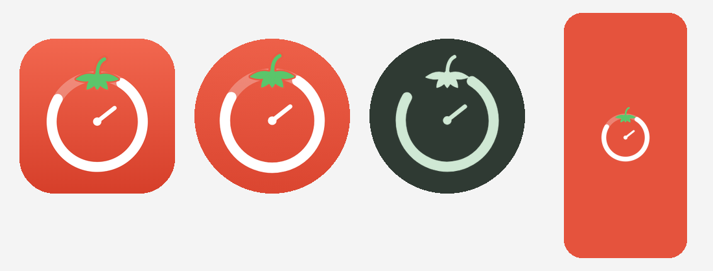

# 🍅 Pomodoro

iOS ve Android için tek kod tabanlı (Expo / React Native), sade bir Pomodoro odak zamanlayıcısı.

## Özellikler
- Odak (25 dk), kısa mola (5 dk), uzun mola (15 dk) modları
- Dairesel ilerleme halkası, başlat / duraklat / sıfırla / atla
- Her 4 odak seansında bir otomatik uzun mola (ayarlanabilir)
- Uygulama arka plandayken süre bitince bildirim
- Zamanlayıcı çalışırken ekran kapanmaz, dokunsal geri bildirim
- Günlük tamamlanan seans sayacı, kalıcı ayarlar
- Türkçe / İngilizce (cihaz diline göre)

## Çalıştırma
```bash
npm install
npx expo start      # telefonda Expo Go ile QR kodu okutun
```

## Mağazalara yayınlama (EAS)
```bash
npx eas-cli@latest login
npx eas-cli@latest build --platform all
npx eas-cli@latest submit --platform all
```
Gerekenler: Apple Developer hesabı (yıllık 99 $) ve Google Play Console hesabı (tek seferlik 25 $).

## İkon ve açılış ekranı
Tüm ikon/açılış görselleri `design/generate.py` ile SVG'den üretilir (renkleri ve şekli oradan değiştirebilirsiniz):
```bash
python3 design/generate.py   # Pillow ve Chromium gerekir
```


## Mağaza ekran görüntüleri
Hazır görseller `store/screenshots/` altında (İngilizce `en`, Türkçe `tr`):

| Klasör | Boyut | Nereye |
|---|---|---|
| `ios-6.9/` | 1320×2868 | App Store – iPhone 6,9" |
| `ipad-13/` | 2064×2752 | App Store – iPad 13" |
| `android-phone/` | 1080×1920 | Google Play – telefon |
| `google-play-feature/` | 1024×500 | Google Play – öne çıkan görsel |

Yeniden üretmek için (uygulamadaki gerçek ekranlar yakalanır):
```bash
npx expo export --platform web --output-dir /tmp/web
npx http-server /tmp/web -p 8765 -s &
node store/capture.mjs /tmp/raw     # ekranları yakalar
node store/compose.mjs /tmp/raw     # başlık + cihaz çerçevesiyle birleştirir
```
Başlık metinleri `store/compose.mjs` içindeki `COPY` bölümünden değiştirilebilir.

## Mağaza metinleri ve gizlilik
- Mağaza açıklamaları (ad, alt başlık, açıklama, anahtar kelimeler): [`store/listing/en.md`](store/listing/en.md), [`store/listing/tr.md`](store/listing/tr.md)
- Gizlilik politikası: [`PRIVACY.md`](PRIVACY.md) — her iki mağaza da bir gizlilik politikası URL'si ister; bu dosyanın GitHub bağlantısı kullanılabilir (depo herkese açık olmalı).
